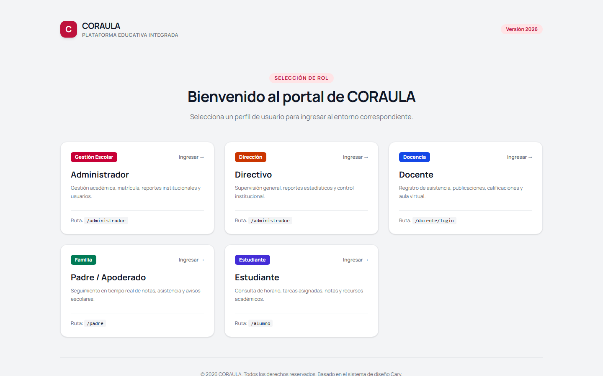
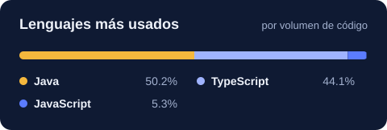

  
  
  <!-- Cuando el portafolio esté publicado, descomenta y pon la URL:
  
  -->

Estudiante de noveno ciclo de **Ingeniería de Sistemas en la UTP** (Lima, Perú), enfocado en **backend con Java y Spring Boot**. Diseño los sistemas con arquitectura hexagonal, los protejo con JWT y roles, y respaldo cada módulo con pruebas automatizadas.

Busco **prácticas preprofesionales** en desarrollo, sistemas o TI.

## Proyectos destacados

<table>
  <tr>
    <th align="left">Proyecto</th>
    <th align="left">Lo que hice</th>
    <th align="left">Enlaces</th>
  </tr>
  <tr>
    <td valign="top">
      <strong>CORAULA</strong> 
      Gestión académica, 2026 
      Java 17, Spring Boot 3.4, PostgreSQL, Next.js 16
    </td>
    <td valign="top">
      La mayor parte del backend con arquitectura hexagonal y el módulo de administrador completo. Autenticación con JWT, roles, bloqueo por intentos fallidos y auditoría. El equipo mantiene más de 700 pruebas con CI.
    </td>
    <td valign="top">
      <a href="https://coraula-front.vercel.app">Demo</a> 
      <a href="https://github.com/Jhair-Maldonado/CORAULA-FRONT">Frontend</a>
    </td>
  </tr>
  <tr>
    <td valign="top">
      <strong>SIVI</strong> 
      Ventas e inventario, 2025–2026 
      Java, Spring Boot, React, Gemini
    </td>
    <td valign="top">
      Asistente con Gemini que consulta ventas, inventario y proveedores según el rol del usuario. Toda la reportería exportable a PDF y Excel, y el módulo de órdenes de compra con actualización de stock.
    </td>
    <td valign="top">
      <a href="https://sivi-front.pages.dev">Demo</a> 
      <a href="https://github.com/Jhair-Maldonado/SIVI_FRONT">Frontend</a>
    </td>
  </tr>
  <tr>
    <td valign="top">
      <strong>Chatbot de tareas</strong> 
      Curso de Lenguajes de Programación, 2025 
      Python, Gemini, PyDatalog
    </td>
    <td valign="top">
      Gestiona tareas en lenguaje natural: Gemini traduce la instrucción a predicados lógicos y el estado cambia solo con funciones puras.
    </td>
    <td valign="top">
      <a href="https://github.com/Jhair-Maldonado/GestionTareas_Gemini">Repositorio</a>
    </td>
  </tr>
</table>

CORAULA: cada perfil entra a su propio entorno con permisos distintos.

<!-- Cuando la demo de SIVI tenga datos de prueba, agrega aquí su captura:

-->

  
<strong>Otros trabajos</strong>

   

- [**ParaTodos**](https://github.com/Jhair-Maldonado/ParaTodos): prototipo de tienda inclusiva, auditado con las heurísticas de Nielsen.
- [**InterpretSigns**](https://github.com/Jhair-Maldonado/INTERPRET_SIGNS): reconocimiento de gestos de lengua de señas en el navegador con MediaPipe.
- [**ONG-SISTEM**](https://github.com/Jhair-Maldonado/ONG-SISTEM): gestión de gastos, donaciones y voluntarios para una ONG.
- **Gestión de maquinaria pesada:** requerimientos, diseño funcional y arquitectura técnica.

## Con qué trabajo

**A diario**

**Aprendiendo**

También: Spring Security, JUnit, Flyway, JWT y BCrypt, APIs REST, levantamiento de requerimientos y especificación SRS.

## Cómo trabajo

- **El dominio primero.** Las reglas de negocio no dependen del framework; la base de datos, la seguridad y la IA son adaptadores.
- **La seguridad desde el diseño.** Roles, permisos y auditoría se definen antes de escribir el primer endpoint.
- **Pruebas e integración continua.** Un cambio se une a la rama principal cuando pasa sus pruebas.
- **La IA con límites.** El asistente de SIVI solo responde con los datos que el rol del usuario puede ver.

## Ahora mismo

- Preparando las certificaciones **Oracle Java OCA y OCP**.
- Publicando demos de CORAULA y SIVI con datos de prueba.

<picture>
  <source media="(prefers-color-scheme: dark)" srcset="https://raw.githubusercontent.com/Jhair-Maldonado/Jhair-Maldonado/output/github-snake-dark.svg" />
  
</picture>

  
<strong>English</strong>

   

Ninth-term **Systems Engineering** student at UTP in Lima, Peru, focused on **backend development with Java and Spring Boot**. I build systems with hexagonal architecture, secure them with JWT and role-based access, and back every module with automated tests. I'm looking for an **internship** in software or IT.

- **CORAULA** (academic management): wrote most of the backend and the full admin module; JWT, roles, account lockout and auditing; 700+ team tests with CI. [Demo](https://coraula-front.vercel.app)
- **SIVI** (sales and inventory): role-aware Gemini assistant, all reporting with PDF and Excel export, and the purchase order module. [Demo](https://sivi-front.pages.dev)
- **Task chatbot**: natural-language task manager combining Gemini, logic programming and pure functions. [Repo](https://github.com/Jhair-Maldonado/GestionTareas_Gemini)

English: intermediate technical reading, basic conversation.

---

Escríbeme a <a href="mailto:jhairmaldonadoquintana@gmail.com">jhairmaldonadoquintana@gmail.com</a> o por <a href="https://www.linkedin.com/in/jhair-junior-maldonado-quintana-b319b3273">LinkedIn</a>.
